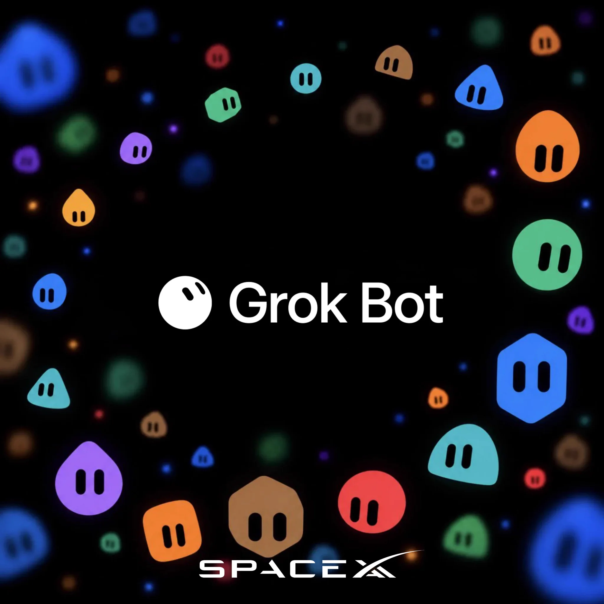

# Grok Bot

SpaceX **Grok Bot** are long-lived AI agents that live on a cloud computer.  

Bots can
- Keep memory across conversations.
- Connect to your email, calendar, files, repos, and tools.
- Run scheduled or event-triggered routines even when you’re away.  
- Handle recurring work or anything that needs to persist and act in your digital world.
- Be reached via phones, computers and Tesla cars.

### Import Ideator
If you're using Grok Bot
- [Get your own free Ideator bot](https://forms.gle/EEa9tBV2Xqge5KNr9).

If not, please continue reading about how to get Grok Bot running.

## Get them Grok Bots running
So, Grok Bot is new to you, right? Here's how to get that fixed, in minutes:

`Grok Bots needs Premium X-Subscription, or higher.`
- Pick your [X-Subscription](https://x.ai/pricing) plan.
- Install [Grok Bot Desktop](https://x.ai/bot).

That's it...Congratulations and welcome to the Grok Bot Whisperer Club.
- Get ready to automate everything and everyone around you.
- Don't forget to [import Ideator bot](#import-ideator).

## Resources
- Ideator [documentation](https://github.com/RonniKahalani/Ideator/blob/main/README.md) and [discussion](https://github.com/RonniKahalani/Ideator/discussions).
- Discord invite: [Grok Bot Ideation](https://discord.gg/6CNgtzuPPH).
