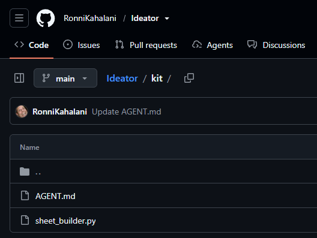

# Kit

This feature enables Ideator to download files, from a remote GitHub folder, to its cloud node.

Used to update resources, like scripts, data, prompts, skills, rules and alike.

## How it works
When giving a problem task, the bot checks for updates from a kit repo, defined by the `kit` [knob](KNOBS.md).

- Downloads new and updated files to Ideator folder.
- If local- and repo file hash differs, download it.

## Changing the kit repo
- The deafult `kit` value is https://github.com/RonniKahalani/Ideator/tree/main/kit
- You can set your own kit repo url via the `kit` [knob](KNOBS.md).

## See also
- Using the [AGENT.md](AGENT.md) for AI instructions.
