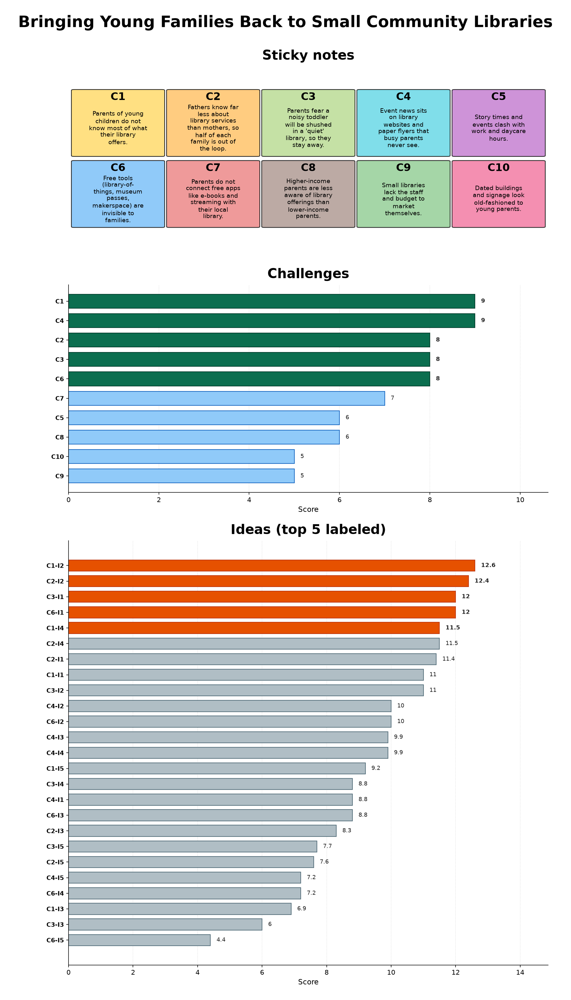

# Ideator Grok Bot 

By [Learning Is Living](http://learningisliving.dk), Denmark | [X](https://x.com/RonniKahalani) | [LinkedIn](https://www.linkedin.com/in/kahalani)

## What Ideator does

Takes a problem statement, research related challenges and generates testable ideas.

Cuts traditional product design research- and test time (costs), from weeks to minutes.

### Following knowned processes, methods and principles:
- [Double Diamond](https://docs.google.com/presentation/d/1YpWFWuR4q4RbrE0vdfk1FYzsovVbZlOvFg2C3JraDE0/edit?usp=sharing) design process (discover, define, develop, deliver).
- [Pretotyping](https://www.pretotyping.org) creates small fake-it tests to prove whether people really want your product, service or solution, before anyone starts doing hard work, like building an expensive prototype.

### Research
* Research the web for real evidence about your problem.
* Explores complaints, reviews, forum threads, articles and how competitors handle it.  
* Turns that evidence into challenges, each tied to a research source.
* Anything it can’t source is labeled a hypothesis.
* It never invents sources, quotes or numbers.  
* Rates and ranks the challenges.

### Ideas
* Generates ideas for the picked challenges, then scores and ranks the ideas.  
* Mixes the best ideas into concepts and writes pretotype tests with a hypothesis, a success number, a deadline, and go or no-go rules.  

### Pretotyping
* Drafts the materials a person needs to run each recommended first test, such as fake-door copy, email or SMS scripts and survey questions.
* It only prepares them; it never sends, publishes or posts anything.

### Files
* Saves a report file per problem, two files if the format knob equals 'both' (Both a Markdown- and web page file).
* Generates a board image (PNG).

## Report file formats

Here are some full sample reports in the different formats:

* [Sample Markdown report](samples/community-library-visitors.md) (simple text)  
* [Sample HTML report](samples/community-library-visitors.html) (styled web page)

## Visual board

A visual board image is generated at the end, which includes:

* Sticky notes, selected challenges and ideas.

## Further details
- [Phases](PHASES.md)
- [Knobs](KNOBS.md)
- [Scoring](SCORING.md)
- [How to](HOWTO.md)
- [Comparison](COMPARE.md)
- [Pretotyping](PRETOTYPE.md)
- [Marketplace](MARKET.md)

## A closing line

So in short, you receive research-backed findings with source links, scored and ranked challenges and ideas, concepts, testable pretotype plans with their materials, and a visual board of the whole run. Later, after you report test results, Ideator adds the go, no-go or iterate decision to the same file.

Ideator will set up a check-in once you tell it a start date.

## What Ideator does not do

- It does not send, publish or post anything. It only prepares pretotype materials.  
- It does not use personal facts about you in a run. Only the problem statement, your message and fresh research count.  
- It does not delete anything.
