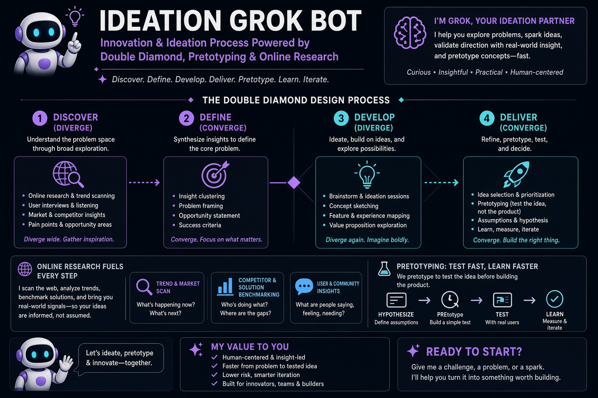

# Ideator

By [Learning Is Living](http://learningisliving.dk), Denmark | [X](https://x.com/RonniKahalani) | [LinkedIn](https://www.linkedin.com/in/kahalani)

## What Ideator is
An AI-Agent (Grok Bot) acting as a hybrid between a creative director and a high-performance product development team, who eats complex problems for breakfast, researches the problem domain, creates cheap testable ideas and delivers a report, in minutes, eagerly waiting to facilitate test plans.

## Problem solving process
### The process explained visually
- These [diagrams](UML.md) explains exactly how the problem solving process works and what's under the hood.

### A tasks runs in one of two modes
- `ask` - Asks the user for decisions in each [phase](PHASES.md).
- `auto` - No interruptions, does all decisionmaking by itself.

### A tasks ends with a report
- [Google Sheet Report Sample](https://docs.google.com/spreadsheets/d/1HZpJBYYJQtU06iVmak6Kp8x2TslsaGx1/edit?usp=drive_link&ouid=106568148712124039315&rtpof=true&sd=true).
- Use `template` [knob](KNOBS.md) to select another template sheet.

## What Ideator does
- Takes a problem statement, researches related challenges and generates testable ideas.
- Cuts traditional research- and test time (costs), from weeks to minutes.

### Kit updates
When giving a problem task, the bot checks for updates from a remote [kit](KIT.md) repo, defined by `kit` [knob](KNOBS.md).

### Follows well-known design processes and principles
- [Design Thinking](https://grokipedia.com/page/Design_thinking)
    - Helps tackling complex problems by prioritizing empathy for end-users, collaborative ideation, rapid prototyping, and continuous testing to generate innovative solutions.
- [Double Diamond](https://docs.google.com/presentation/d/1YpWFWuR4q4RbrE0vdfk1FYzsovVbZlOvFg2C3JraDE0/edit?usp=sharing)
    - A visual framework representing the design and innovation process, with its 4 phases (discover, define, develop, deliver).
- [Google Design Sprint](https://grokipedia.com/page/Design_sprint)
    - A five-day process for answering critical business questions through design, prototyping, and testing ideas with customers.
- [Pretotyping](PRETOTYPE.md)
    - Small fake-it tests to prove whether people really want your idea, before anyone starts building an expensive prototype.
- [The Startup Way](https://www.thestartupway.com)
    - Build - Measure - Learn, YODA, MVP testing, pivot or persevere.

### Research problems and related challenges
* Research the web, in realtime, for real evidence about your problem.
* Explores complaints, reviews, forum threads, articles and how competitors handle it.  
* Turns that evidence into challenges, each tied to a research source.
* Anything it can’t source is labeled a hypothesis.
* It never invents sources, quotes or numbers.  
* Rates and ranks the challenges.
* You can limit the number of research sources, via the `sources` [knob](KNOBS.md).

### Generate and conceptualize ideas
* Generates ideas for selected challenges, then scores and ranks the ideas.  
* Mixes the best ideas into concepts.
* You can limit the number of ideas per challenge, via the `ideas` [knob](KNOBS.md).

### Pretotype user tests
* Writes pretotype tests with a hypothesis, a success number, a deadline, and go or no-go rules.  
* Drafts the materials a person needs to run each recommended first test, such as fake-door copy, email or SMS scripts and survey questions.
* It only prepares them; it never sends, publishes or posts anything.
* You can limit the number of pretotype tests across concepts, via the `pretotypes` [knob](KNOBS.md).

### Generate reports
- Create report sheet locally with `sheet_builder.py` and upload it to Google Drive root.
- The `sheet_builder.py` script can be updated locally, via the [kit feature](KIT.md).
- [Google Sheet Report Sample](https://docs.google.com/spreadsheets/d/1HZpJBYYJQtU06iVmak6Kp8x2TslsaGx1/edit?usp=drive_link&ouid=106568148712124039315&rtpof=true&sd=true).
- Use `template` [knob](KNOBS.md) to select another template sheet.

Use the `template`knop to reference an existing Sheet to use as a template. Enabling custom branding and features.

## Dependencies
List of current dependencies to integrations, connectors or plugins.
| Type | Purpose |
| :---- | :---- |
| Google Drive connector| For generating Google Sheet reports. | 

## Workload and processing time

The realtime web research- and report generation tasks consumes the most credits and time.

An average problem statement report can take 5-10 minutes, or more, depending on the [knob](KNOBS.md) settings.

## Get your own Ideator bot
- Are Grok Bots new to you? [Get them Grok Bots running](GROKBOT.md).

- Already using Grok Bots? [Get Ideator Grok Bot](https://forms.gle/EEa9tBV2Xqge5KNr9).

## Further details
- [Business Case](BUSINESSCASE.md)
- [Grok Bots](GROKBOT.md)
- [How to use it](HOWTO.md)
- [Human vs. AI](COMPARE.md)
- [Kit](KIT.md)
- [Knobs / Parameters](KNOBS.md)
- [Marketplace](MARKET.md)
- [Phases](PHASES.md)
- [Pretotyping](PRETOTYPE.md)
- [Scoring & Rating](SCORING.md)
- [UML](UML.md)

## Closing line

In short, you get 
- Research-backed findings with source links.
- Scored and ranked challenges and ideas.
- Concepts with testable pretotype plans and materials.
- Visual board and report of the whole run.

Later, after you report back on the pretotype test results, Ideator can
- Add a go, no-go or iterate decision to the same file.
- Set up a check-in once you tell it a start date.

## Contact
- [Discussion](https://github.com/RonniKahalani/Ideator/discussions).
- Discord Invite: [Grok Bot Ideation](https://discord.gg/6CNgtzuPPH).
- [Learning Is Living](https://learningisliving.dk/about/contact).