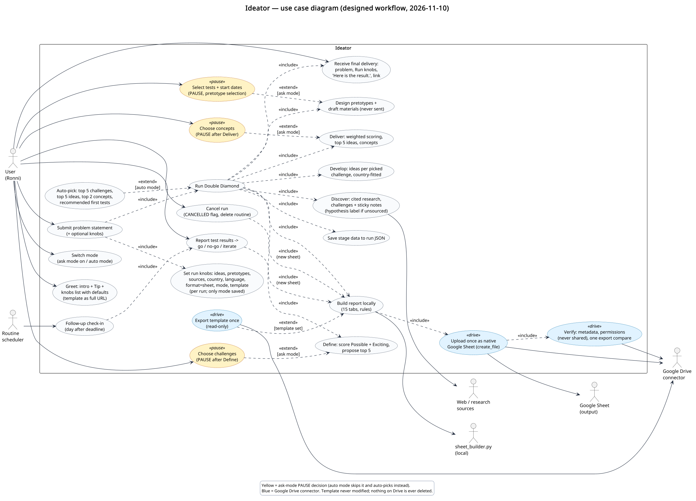
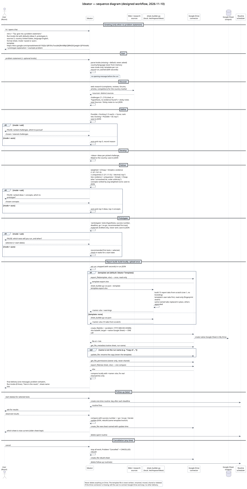
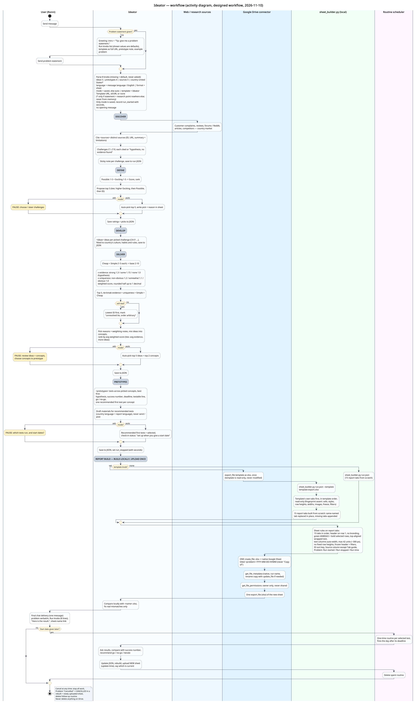

# UML - Problem solving and decisions

# Use cases

[View PlantUML](samples/ideator-use-case.puml)

# Sequence

[View PlantUML](samples/ideator-sequence.puml)

# State Machine

[View PlantUML](samples/ideator-state-machine.puml)

# Workflows

[View PlantUML](samples/ideator-workflow.puml)
